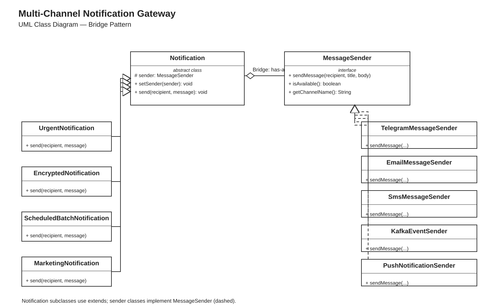

# Assignment 3 — Multi-Channel Notification Gateway

**Course:** Software Design Patterns  
**Java:** 17+  
**Design Pattern:** Bridge

## About
This is a beginner-level Java console application that **simulates** sending notifications through Telegram, Email, SMS, Kafka, and Push. It demonstrates a Bridge between different notification types and delivery channels.

## UML Class Diagram



Editable version: [class-diagram.drawio](uml/class-diagram.drawio).

## Requirements
- Interface: `MessageSender`
- Senders: Telegram, Email, SMS (160-character limit), Kafka, Push
- Notifications: Urgent, Encrypted, ScheduledBatch, Marketing
- Sender can be replaced at runtime with `setSender()`
- Urgent notifications use a fallback channel when the main sender fails
- Six demonstration scenarios in `Main.java`
- 18 JUnit 5 tests
- Editable UML in `uml/class-diagram.drawio`, open with https://app.diagrams.net/

## Run
Open this folder as a Maven project in IntelliJ IDEA and use Java 17 or newer.

```bash
mvn clean test
mvn exec:java
```

## Bridge questions

**1. What are the two independent dimensions?** Notification types and delivery channels.

**2. Where exactly is the Bridge?** The `protected MessageSender sender` reference inside the abstract `Notification` class.

**3. Why is inheritance problematic here?** Without Bridge we would need a different class for each combination (such as UrgentEmailNotification and UrgentSmsNotification).

**4. What happens when a new provider is added?** Create a class implementing `MessageSender`. Existing notification classes do not need changes.

**5. What happens when a new Notification type is added?** Create a class extending `Notification`. Existing senders do not need changes.

**6. Why is this Bridge rather than Adapter?** Bridge separates two dimensions that can vary independently; Adapter makes incompatible interfaces work together.

## Why add Push and Marketing?
Push shows that we can extend the sender side independently. Marketing shows that we can extend the notification side independently.

## How fallback works
`UrgentNotification` tries the primary sender. If it is unavailable or returns `false`, it tries its fallback `MessageSender`. It never needs `instanceof` to check sender classes.

## Notes
SMS returns `false` if a message is longer than 160 characters. The batch example sends to a list and counts success/failure, but does not implement a real timer. Base64 is a demonstration of encoding, not secure encryption. No real external APIs are used.

## Defense ideas
- Add WhatsApp by implementing `MessageSender`.
- Change `MAX_LENGTH` from 160 to 120 in `SmsMessageSender`.
- Add `SilentNotification` extending `Notification`.
- Mark a sender unavailable with `setAvailable(false)`.
- Swap sender at runtime with `setSender()`.
- Change fallback with `setFallbackSender()`.
